# Informe del rediseño de Mi Plato Fácil (v14.9.94 → v15.9.0)

Este informe resume las 11 etapas del plan (`docs/plan-rediseno.md`). El detalle de cada una (plan, decisiones, medidas, revisores) está en su sección del **Registro** de ese archivo. Todo el trabajo está en la rama `rediseno`; no se tocó `main`. **El merge a `main` es tuyo.**

## 1. Qué cambió para quien usa la app

- **Hoy** explica el método del plato en una línea y tiene una acción principal clara ("Elegir" tu almuerzo). Las 4 comidas del día se eligen y se marcan "Lo comí" sin salir de la pantalla, con Deshacer. El chip "Hoy entrenás · cambiar" evita preguntar "¿Entrenás hoy?" cuando la rutina ya lo sabe. "Sugerime algo" reemplaza a "Plato del día" y "Sugerir al azar" como entradas (las dos funciones siguen existiendo adentro).
- **Semana** pasó de 28 bloques con 28 selectores a un día por vez, con chips de lunes a domingo. Un hueco vacío abre el **Selector de comida** (hoja inferior con buscador, Recientes, Mis comidas, Ideas, Armar nueva y Sugerime): asignar una comida lleva 3 toques o menos. Lo avanzado (repetir la semana anterior, copiar un día, vaciar, planes guardados, semanas anteriores, historial, descargar) está en el menú ⋯. Una semana nueva pregunta "¿Repetís el plan o empezás de cero?" y guarda una copia fechada antes de vaciar.
- **Comidas** es una sola pantalla "Mis comidas | Ideas" con una tarjeta única para platos y recetas (los datos siguen separados). Las recetas salieron de "Con lo que tengo". Armar, escribir o pegar con IA una receta sale de "+ Nueva". El catálogo de ideas suma 12 platos comunes en Argentina y cada idea se puede guardar y agregar a la semana.
- **Compras** es "Lista | Despensa". La lista va por secciones del súper, con cantidades legibles (redondeadas y en plural), tachados que sobreviven a recargar, y lo que ya tenés o ya compraste en grupos plegados. "Terminé de comprar" suma a la despensa (solo lo que faltaba) y permite anotar el gasto. Las calculadoras sueltas pasaron a un menú ⋯ y a la lista misma.
- **Precios automáticos**: precio por ítem y total en la lista, costo por porción en cada comida y por día y semana en Semana, con la región elegible en Preferencias. Fuentes: INDEC (mensual) y SEPA – Precios Claros (semanal), siempre con "≈", fuente y fecha visibles. **Tu "Mi precio" siempre gana.** Vienen apagados por defecto ("Mostrar precios y presupuesto" en Preferencias).
- **Un solo Registro** (Más → Registro): "Lo comí" y "Lo cociné" por día, con Quitar y Deshacer. Reemplaza a los cinco registros parecidos.
- **Más** es un índice: Mi rutina, Preferencias (evitar, objetivos, presupuesto, precios, herramientas avanzadas), Mis datos (respaldo, importar y exportar), Asistente de IA (pantalla propia), Apariencia, Fuentes de datos y Cómo funciona.
- **Primera vez**: 3 pantallas (el método del plato con dibujo, rutina opcional, elegir ideas para arrancar). Se vuelve a ver en Más → Cómo funciona.
- **Desayuno y listas**: el paso Frutas pide qué fruta (16 opciones) y aparte la forma; la lista de compras ya no pide "En trozos" ni "Huevo | Clara de huevo". Al guardar una comida se sugiere un nombre editable. Las verduras y otras listas largas van en una grilla de chips con buscador.
- **Pulido**: el botón flotante "Consejos" no existe más (las ideas viven en Comidas); contraste corregido en tema oscuro; estados vacíos con un próximo paso; todos los campos con etiqueta.

## 2. Cómo se validó

- Cada etapa pasó por `node herramientas/validar-etapa.mjs N`, que revisa: construcción al día, todas las pruebas en verde, que no baje la cantidad de pruebas ni se pierda una clave, que el respaldo de ejemplo se restaure completo, capturas sin errores de JavaScript ni scroll horizontal, y los controles de `docs/validacion/criterios.json` (nada vuelve atrás y no puede ser más permisivo que en el tag `etapa-0-ok`). Salida final: **"VALIDACIÓN ETAPA 10: OK (67 controles)"**.
- **Pruebas: de 375 a 545** (de 29 a 41 baterías), sin borrar ninguna; las que miraban la interfaz vieja se adaptaron, y cada adaptación está explicada en el Registro.
- Dos revisores independientes con contexto limpio (uno de código sobre el plan y sobre el diff, otro de usuario sobre las capturas antes y después) dieron NO BLOQUEANTE en cada etapa, después de corregir lo bloqueante: el plan de varias etapas fue marcado BLOQUEANTE (por ejemplo, registros que se descartaban en silencio, un control del 80 % que dejaba afuera casi la mitad, topes de palabras que se cumplían solo por mudar paneles) y se resolvió antes de programar.
- Al terminar, la tarea mensual de nutrición commiteó en `main` (`a4c3fd4`, solo `datos/nutricion.json` e `index.html`). Se trajo a `rediseno` con merge, se reconstruyó y se repitió la compuerta completa. Ese paso destapó una prueba que ya existía (N16 de nutrición) con la fecha de los datos escrita a mano, que se habría roto con cada revisión mensual; se corrigió para que compare con la fecha real, sin perder exigencia (detalle en el Registro, "Cierre").
- Tags `etapa-0-ok` a `etapa-10-ok`, publicados. Las pruebas de GitHub del PR dieron "success" en cada push. Las dos tareas de precios (INDEC y SEPA) corrieron en el PR con datos reales.

## 3. Medidas antes y después

Entorno: Windows 10.0.22631, Chrome 156, 390×844, reloj fijo (lunes 26/10/2026 12:00) y el respaldo de ejemplo. Tema claro. Alto en px / palabras visibles.

**Estado normal** (modo simple, con los datos del respaldo de ejemplo):

| Pantalla | Antes (v14.9.94) | Después (v15.9) |
|---|---|---|
| Hoy | 896 px / 58 | 1.127 px / 77 |
| Semana | 8.118 px / 1.695 | 1.080 px / 197 |
| Compras | 3.820 px / 438 | 2.994 px / 209 |
| Comidas (antes Mis comidas) | 3.811 px / 459 | 2.319 px / 288 |
| Más | 964 px / 74 | 976 px / 63 |
| Despensa (antes Con lo que tengo) | 4.824 px / 653 | 3.146 px / 171 |
| Mi rutina (entrenamiento) | 1.895 px / 159 | 1.895 px / 159 |
| Respaldo | 1.305 px / 152 | 1.062 px / 52 |
| Asistente de IA | 1.966 px / 311 | 975 px / 83 |
| Ideas (antes botón Consejos) | 3.786 px / 366 | 2.533 px / 163 |
| Armado: desayuno | 1.276 px / 51 | 1.416 px / 71 |
| Armado: almuerzo / cena (primer paso) | 844 px / 18 | 1.544 px / 56 |
| Armado: verduras | 2.536 px / 57 | 1.544 px / 55 |
| Resumen del armado | 1.169 px / 49 | 1.148 px / 50 |

**Estado todo** (herramientas avanzadas y precios activados, paneles abiertos):

| Pantalla | Antes | Después |
|---|---|---|
| Semana | 12.357 px / 2.225 | 1.130 px / 211 |
| Compras | 15.279 px / 1.857 | 4.167 px / 393 |
| Despensa | 9.825 px / 1.756 | 4.681 px / 606 |
| Comidas | 5.826 px / 684 | 3.240 px / 412 |
| Respaldo | 2.751 px / 484 | 1.387 px / 101 |
| Asistente de IA | 2.751 px / 484 | 1.105 px / 129 |
| Ideas | 3.786 px / 366 | 5.009 px / 713 |

**Lo que no mejoró, dicho con franqueza:** Hoy (+231 px, +19 palabras), el primer paso del armado de almuerzo (porque ahora arranca directo en Verduras, en vez de preguntar "¿Entrenás hoy?") y Ideas con todo abierto (la pantalla ahora trae 41 ideas y sus herramientas) crecieron. Más con todo abierto y Mi rutina no cambiaron.

| Control sobre todas las capturas | Antes (84 capturas) | Después (162 capturas) |
|---|---|---|
| Controles superpuestos | 40 | 0 |
| Textos cortados | 174 | 0 |
| Elementos fuera de pantalla | 0 | 0 |
| Campos sin etiqueta | 0 | 0 |
| Textos con poco contraste (< 4,5:1) | no se medía | 0 (20 deshabilitados y 18 sobre imagen quedan afuera y están contados) |

Capturas antes y después (recortadas a las primeras dos pantallas):

| Antes | Después |
|---|---|
| 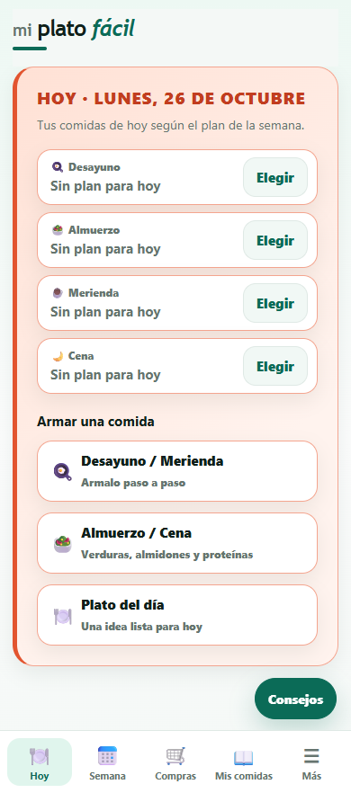 | 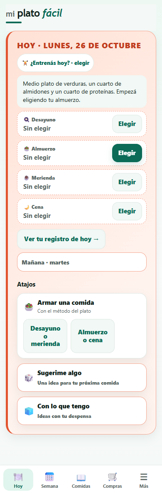 |
| 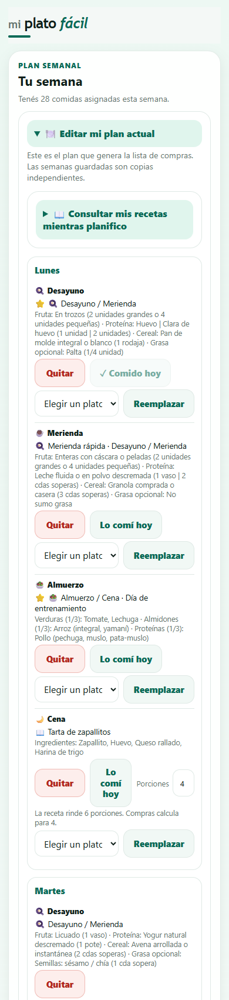 | 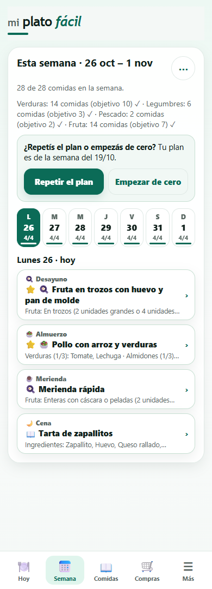 |
| 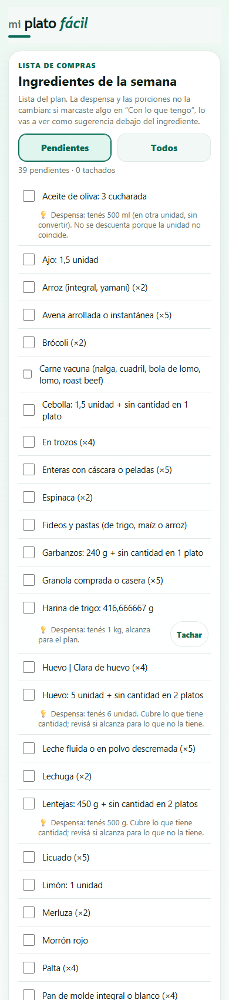 | 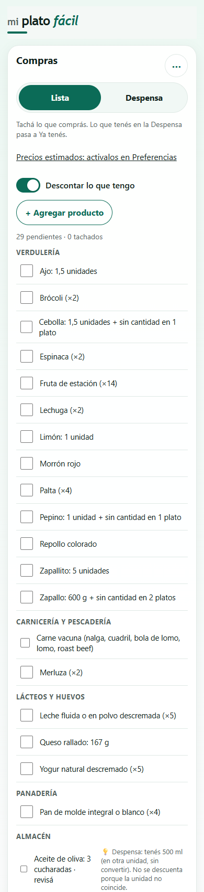 |
| 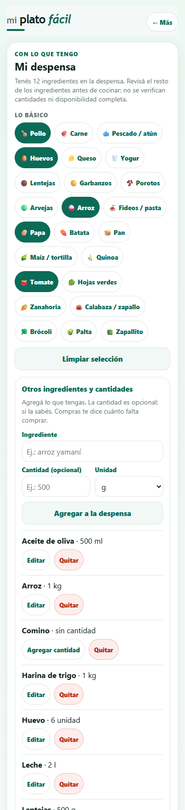 | 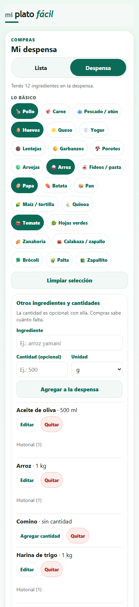 |
| 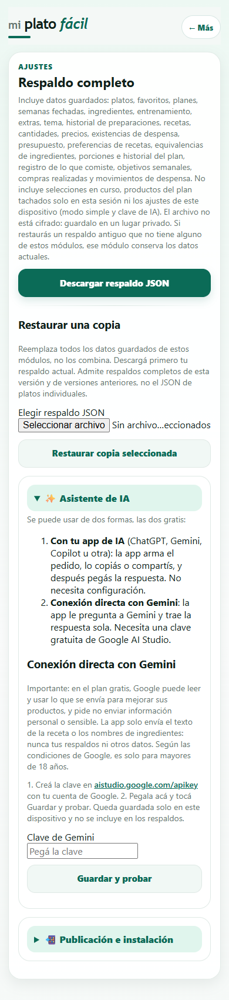 | 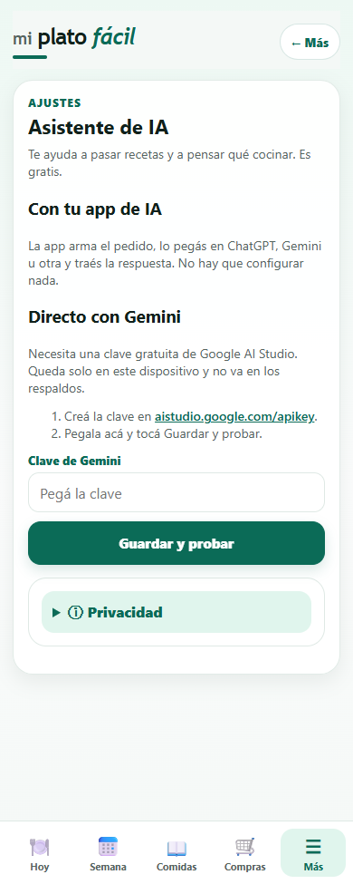 |
| 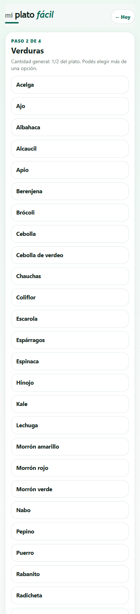 | 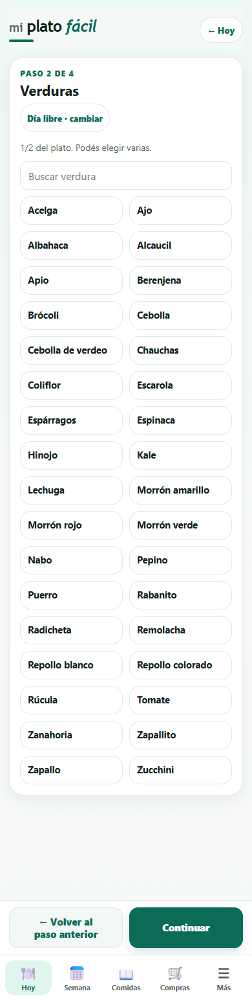 |
| 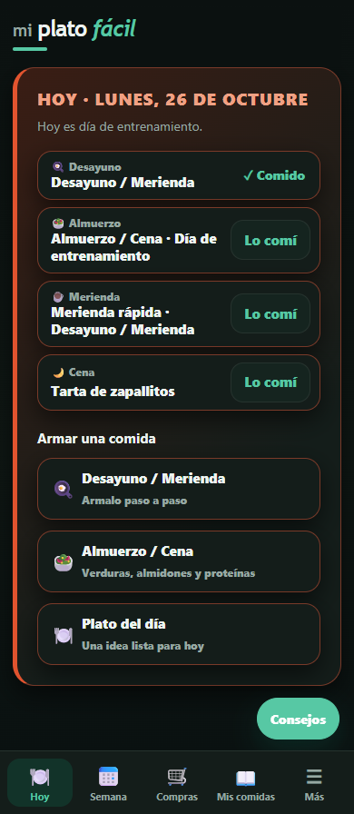 | 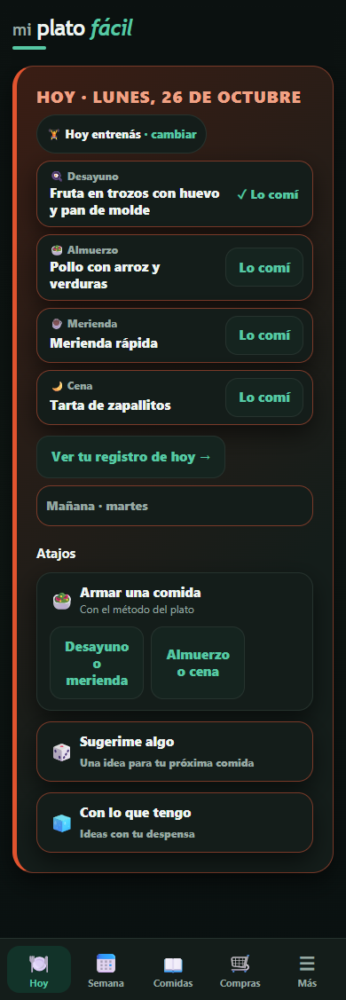 |

## 4. Tus datos

- **No se renombró ni se borró ninguna clave `miPlatoFacil_*`**, y no cambió ningún formato guardado de forma incompatible. Los platos viejos se corrigen al mostrarlos (nombres, "Huevos", formas de fruta) sin reescribir lo guardado.
- **5 claves nuevas**, todas opcionales en el respaldo y validadas al restaurar: `shoppingChecks_v1` (tachados y comprados por semana), `bienvenida_v1`, `comprasOpciones_v1` ("Descontar lo que tengo"), `region_v1` y `mostrarPrecios_v1` (se deriva de `uiMode_v1` mientras no la toques; `uiMode_v1` no se modifica).
- Los respaldos de la v14.9.94 se restauran completos (hay un respaldo de ejemplo en `pruebas/fixtures/` con los 24 módulos y una prueba que lo restaura byte a byte).
- Los registros de "Lo cociné" y "Lo comí" ya no descartan en silencio los registros guardados que no pasan la validación, y todo lo que se quita se puede deshacer.

## 5. Decisiones que tomé sin vos (las más importantes)

1. **Ramas `rediseno-etapa-N-tema`** en vez de `rediseno/etapa-N-tema`: git no permite las dos a la vez.
2. **La lista de compras ya no es "intocable"**: nada se borra, pero lo que ya tenés en la despensa o ya compraste pasa a grupos plegados ("Ya tenés", "Ya en tu despensa"), como pide la Etapa 1. Esto reemplaza la regla anterior de que la lista no cambia.
3. **Precios apagados por defecto**, con una línea en Compras que lleva a activarlos. Antes el modo simple y los precios eran el mismo interruptor; se separaron en dos (Etapa 8).
4. **Fuentes de precios**: SEPA primero, INDEC después, siempre con "≈", fuente y fecha; "Mi precio" gana. GBA es "CABA más Buenos Aires con código postal 1600 a 1899". Un precio de SEPA exige 10 observaciones en 3 banderas distintas y se descarta si difiere más del doble del de INDEC. Los enlaces de atribución (CC BY 4.0) viajan dentro del archivo de precios y no en el código de la app.
5. **El control del 80 % de ingredientes con precio** exige el total de 97 ingredientes (ideas del catálogo, comidas de ejemplo y opciones del armado), con tope de aproximados del 15 %: 81 de 97 (83,5 %), 11 aproximados.
6. **Nada de recortes con "…"** para arreglar textos cortados: el texto ajusta o la etiqueta es corta con el detalle debajo. Costo: la fecha del precio en el selector de Comparar alternativas pasó a un tooltip, y la línea de fuente ya no avisa que algunos ítems usan INDEC como respaldo.
7. **La pestaña "Comidas"** mantiene su clave interna `miscomidas`; el título de la pantalla sigue siendo "Mis comidas".
8. **Eliminar sigue pidiendo confirmación** en vez de ofrecer Deshacer (en Comidas); el resto de los borrados usa Deshacer.

## 6. Mejoras sugeridas (no hechas)

- Detalle de una comida y formulario de receta recargados; "Quitar" suelto en "Otros productos"; "Fuentes de datos" con párrafos largos (5 a 8 líneas por fuente).
- Despensa: un mismo alimento aparece como chip de "Lo básico" y como ítem con cantidad.
- Compras: cantidades con formatos mezclados ("×2", "sin cantidad en 1 plato"); notas de "Ya tenés" de 2 o 3 líneas; con la lista vacía el botón lleno debería llevar a Semana.
- Semana: un solo "faltan N" en el costo del día y de la semana; el aviso de semana nueva empuja los chips hacia abajo.
- Preferencias: títulos de los interruptores largos; la ayuda de "Ingredientes equivalentes" (5 líneas) a ⓘ.
- Registro con todo abierto: formularios repetidos ("Anotar otra comida" y "Registrar preparación").
- Cobertura de precios: puerro, cebolla de verdeo, quinoa y otros quedan sin precio; con provincias en vez de regiones y sinónimos de leche/pan de molde/frutos secos subiría.
- Capturas: no cubren el menú ⋯ de Compras ni Preferencias con precios encendidos; `superpuestos` no mira dentro de las hojas inferiores.
- Un lector de `.xls` con prueba propia en el navegador (hoy lo prueba la tarea de GitHub con cada descarga).
- Cambiar la fecha o la comida de un registro en el lugar (hoy corregir es Quitar y volver a anotar).

## 7. Pendientes para vos

1. **Revisar el PR #1 y hacer el merge a `main`.** Cuando entre a `main`, el flujo "Publicar en GitHub Pages" corre las pruebas y publica la v15.9.0 para las personas que usan la app; la app avisa para recargar y sus datos no se borran. También quedan activas las tareas programadas: nutrición (mensual, el día 3 a las 06:23 UTC) y precios (semanal, los martes a las 06:23 UTC: la primera corre el martes siguiente al merge y commitea `datos/precios.json` y `index.html` en `main`).
2. **Revisar las 12 ideas argentinas nuevas** del catálogo (marcadas `nueva: true` en `fuente/codigo/01-datos-y-estado.js`): nombres, ingredientes vinculados y tags.
3. **Decidir sobre el 80 %**: hoy el control exige el total (83,5 %). Si preferís que exija solo las ideas y comidas de ejemplo (94 %), decilo.
4. **Probar en tu celular**, instalada como app y sin conexión. Todo se midió con Chrome sin ventana a 390×844 (no hubo pruebas en dispositivos reales ni con lector de pantalla), y el revisor de usuario miró con los ojos una muestra de las capturas, no todas.

## 8. Cómo revisarlo

- PR: https://github.com/Facunddominguez/Facunddominguez.github.io/pull/1 (rama `rediseno` → `main`).
- Etapa por etapa: tags `etapa-0-ok` … `etapa-10-ok` y la sección "Registro" de `docs/plan-rediseno.md`.
- Para repetir la validación: `node herramientas/construir.mjs --verificar`, `node herramientas/probar.mjs`, `node herramientas/validar-etapa.mjs 10` (necesita Chrome, Chromium o Edge; `--navegador <ruta>` si no lo encuentra).
